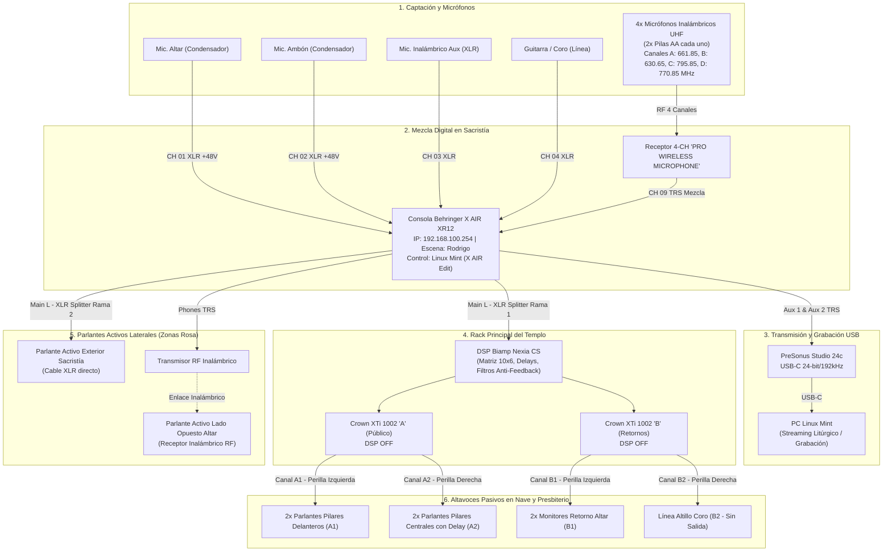

# Contexto del Proyecto: SonidoSanPatricio

Documento maestro de especificación técnica, arquitectura unificada, inventario de hardware, mapeo de puertos y protocolos operativos del sistema integral de audio del templo parroquial **San Patricio de Las Condes** (Santiago, Chile).

---

## 1. Información General y Alcance

* **Proyecto:** SonidoSanPatricio
* **Institución:** Templo Parroquial San Patricio de Las Condes (Santiago, Chile)
* **Sitio Web de Referencia:** [https://rodrigoquezadab.github.io/SonidoSanPatricio](https://rodrigoquezadab.github.io/SonidoSanPatricio)
* **Integrador Original del Rack Central:** Novotic S.A. ([www.novotic.cl](https://www.novotic.cl) • Tel: 02-22113310)
* **Fecha de Actualización Técnica:** Octubre 2026
* **Propósito del Repositorio:** Unificar la documentación técnica de todo el ecosistema de audio (captación, mezcla digital en sacristía, transmisión USB/streaming, amplificación principal del templo y refuerzo sonoro independiente con cajas autoamplificadas) para sacerdotes, sacristanes, encargados de liturgia y sonidistas.
* **Componente Visual Principal:** `index.html` — Aplicación web técnica interactiva con diseño moderno, visor de galería en alta resolución, superposición SVG sobre la fotografía real del templo, esquemas de conexión y modo optimizado para impresión/exportación limpia a PDF.

---

## 2. Inventario de Archivos y Recursos Multimedia

```plaintext
SonidoSanPatricio/
├── .git/                                            # Control de versiones Git
├── index.html                                       # Aplicación web interactiva unificada (Tailwind CSS + SVG + Modo Impresión)
├── README.md                                        # Resumen general del sistema y accesos rápidos
├── CONTEXT.md                                       # Especificación técnica integral y manual maestro (este archivo)
├── Guia Audio Templo.txt                            # Levantamiento técnico y apuntes operativos en texto plano
├── documentacion_sistema_de_audio_san_patricio.txt  # Documentación técnica de referencia
├── Parlante Parroquia San Patricio Manual De Usuario.pdf # Manual de fábrica del parlante activo
│
├── FOTOGRAFÍAS REALES DEL SISTEMA:
├── Rack Templo San Patricio.jpg                     # Fotografía frontal del rack de audio (Biamp Nexia CS + 2x Crown XTi 1002)
├── Equipos de audio input output.jpg                # Fotografía del bloque de sacristía: PRO Wireless + PreSonus Studio 24c + Behringer XR12
├── Configuracion Inferfaz de Audio.jpg              # Pantalla de control X AIR Edit en Linux Mint (escena "Rodrigo", ganancias y faders)
├── Microfonos inalambricos.jpg                      # Fotografía de los 4 micrófonos inalámbricos UHF de mano (usan 2 pilas AA c/u)
├── Parlante Fuera de Sacristia.jpg                  # Fotografía del panel trasero de la caja activa exterior (controles y conexiones)
├── Parlantes Templo San Patricio.jpg                # Fotografía panorámica del templo con los altavoces de columna en los pilares
├── parlantes templo.jpg                             # Fotografía duplicada en alta resolución del interior del templo
└── Diagrama Audio Rack Templo.jpg                   # Infografía arquitectónica oficial de conexión entre el rack y la nave
```

---

## 3. Arquitectura General y Flujo de Señal Unificado (End-to-End)

El ecosistema de sonido se estructura en **cuatro bloques operativos integrados**:

1. **Etapa de Captación y Mezcla Digital (Sacristía):** Consola digital **Behringer X Air XR12** gobernada por red Ethernet (`192.168.100.254`) desde un computador con Linux Mint mediante el software **X AIR Edit** (Escena activa: *"Rodrigo"*). Concentra micrófonos del altar, ambón, guitarras y el receptor UHF de 4 canales.
2. **Etapa de Conversión y Transmisión USB (Sacristía):** Interfaz **PreSonus Studio 24c** conectada por USB-C al computador. Recibe envíos auxiliares balanceados (`Aux 1` y `Aux 2`) desde la consola Behringer para inyectar audio estéreo de alta resolución a transmisiones litúrgicas o grabaciones.
3. **Sistema de Amplificación Principal del Templo (Rack en Sacristía):** La salida principal `MAIN L` de la consola Behringer se bifurca mediante un cable XLR en "Y". La primera rama ingresa a la toma mural de la sacristía alimentando la matriz DSP **Biamp Nexia CS** y los dos amplificadores de potencia **Crown XTi 1002** (Unidad A para la asamblea y Unidad B para retornos del presbiterio).
4. **Sistema de Refuerzo Independiente (Cajas Activas Laterales - Zonas Rosa):** Dos altavoces autoamplificados profesionales ubicados a los costados del presbiterio:
   - *Parlante Derecho (Exterior Sacristía):* Conectado por cable XLR físico a la segunda rama del cable en "Y" que nace en `MAIN L`.
   - *Parlante Izquierdo (Lado Opuesto del Altar):* Conectado mediante enlace de audio inalámbrico RF desde la salida de audífonos (`PHONES`) de la Behringer XR12.

### Diagrama de Flujo (Mermaid)



---

## 4. Equipamiento en la Sacristía (Mezcla, Transmisión y Captación)

### 4.1. Consola Digital: Behringer X AIR XR12
* **Formato y Conectividad:** Caja de mezcla de 12 canales montable en rack. Conectada por puerto `REMOTE` Ethernet a la red local con selector físico en modo `ETHERNET`.
* **Dirección IP Fija:** `192.168.100.254`
* **Software de Control:** *X AIR Edit* corriendo en estación Linux Mint.
* **Escena Guardada:** `"Rodrigo"`
* **Arquitectura de Entradas:**
  - 4 preamplificadores Midas combo XLR/TRS con alimentación Phantom +48V individual.
  - 6 entradas de nivel de línea balanceadas TRS 1/4" (CH 5 a 10).
  - 2 entradas de alta impedancia Hi-Z TRS 1/4" para instrumentos directos (CH 11 y 12).
* **Salidas Físicas:**
  - `MAIN L` (XLR macho): Señal mono maestra principal hacia el sistema de audio.
  - `MAIN R` (XLR macho): Desconectado (el templo opera en señal mono balanceada por Main L).
  - `AUX 1` (TRS 1/4"): Envío balanceado Bus 1 hacia Entrada 1 de la PreSonus Studio 24c (cable con anillo celeste).
  - `AUX 2` (TRS 1/4"): Envío balanceado Bus 2 hacia Entrada 2 de la PreSonus Studio 24c (cable con anillo celeste).
  - `PHONES` (TRS 1/4" estéreo): Envío con control de volumen analógico físico (`LEVEL`) conectado al transmisor de radiofrecuencia hacia el parlante activo del lado izquierdo del presbiterio.

### 4.2. Mapeo Detallado de los 12 Canales de la Consola

| Canal | Tipo de Puerto | Conector Físico | Etiqueta Digital (Software) | Ganancia Preamp | Phantom (+48V) | Nivel Fader | Estado y Función Litúrgica |
| :---: | :---: | :---: | :---: | :---: | :---: | :---: | :--- |
| **CH 01** | XLR Midas | Cable rotulado *"Ambón"* | `01 altar` | +13.0 dB | **ON (+48V)** | -6.0 dB | **Activo:** Micrófono condensador principal de liturgia. |
| **CH 02** | XLR Midas | Cable rotulado *"Ina 01"* | `02 Ambon` | +15.0 dB | **ON (+48V)** | -5.1 dB | **Activo:** Micrófono condensador principal de liturgia. |
| **CH 03** | XLR Midas | Cable XLR negro | `03 Ina 02` | +11.5 dB | OFF | -4.0 dB | **Activo:** Micrófono inalámbrico auxiliar 2. |
| **CH 04** | XLR Midas | Cable XLR negro | `04 guit` | +6.0 dB | OFF | -4.4 dB | **Activo:** Línea de guitarra o coro litúrgico. |
| **CH 05** | TRS 1/4" Línea | Desconectado | `05 Boya` | +8.0 dB | N/A | -4.0 dB | Canal sin conector físico insertado. |
| **CH 06** | TRS 1/4" Línea | Plug 1/4" negro | `06 pc psp` | +1.0 dB | N/A | -22.2 dB | **Muteado:** Retorno de audio desde el computador. |
| **CH 07** | TRS 1/4" Línea | Plug 1/4" metálico | `07 07` | +0.5 dB | N/A | -5.0 dB | **Activo:** Entrada de línea auxiliar. |
| **CH 08** | TRS 1/4" Línea | Plug 1/4" negro | `08 Saram...` | +8.0 dB | N/A | -1.1 dB | **Muteado:** Sistema inalámbrico Saramonic. |
| **CH 09** | TRS 1/4" Línea | Plug 1/4" negro | `09 4 mic` | +7.0 dB | N/A | -4.5 dB | **Activo:** Recibe la mezcla sumada del receptor UHF de 4 micrófonos. |
| **CH 10** | TRS 1/4" Línea | Plug 1/4" negro | `10 CH 10` | +6.0 dB | N/A | -6.7 dB | **Activo:** Entrada de línea disponible. |
| **CH 11** | TRS Hi-Z | Desconectado | `11 CH 11` | +6.5 dB | N/A | -8.8 dB | **Muteado:** Sin conexión física. |
| **CH 12** | TRS Hi-Z | Plug con adaptador | `12 CH 12` | +0.0 dB | N/A | -1.4 dB | **Muteado:** En espera. |

> [!NOTE]
> **Discrepancia de Rotulación en Canales 1 y 2:**  
> Físicamente en la consola Behringer, el conector marcado con la etiqueta adhesiva *"Ambón"* entra al **Canal 1**, mientras que el cable rotulado *"Ina 01"* ingresa al **Canal 2**. No obstante, en la interfaz gráfica de *X AIR Edit*, el software los nombra inversamente: `01 altar` y `02 Ambon`. Ambos canales son micrófonos condensadores con Phantom +48V activo y operan con normalidad.

### 4.2.1. Procedimiento para Intercambiar y Respaldar Configuración entre Canales (Copy / Paste + Preset Temporal)

En caso de requerir intercambiar la configuración completa entre el **Canal 1** y el **Canal 2** para mantener el ruteo físico 1 a 1 (Puerto 1 en Canal 1, Puerto 2 en Canal 2) e intercambiar todos los procesamientos (EQ, Gate, Compresor, Envíos y Nombre) sin anotar nada a mano:

1. **Seleccionar Canal 01:** Hacer clic sobre el `Canal 01 (altar)` (quedará resaltado con un recuadro celeste).
2. **Guardar Preset Temporal (.chn):** Ir a la pestaña `Channel` (arriba a la izquierda, junto a *Mixer*) y hacer clic en `Save` (dentro del bloque de presets de canal) para guardar la configuración del Canal 1 en el PC como `temp_ch1.chn`.
3. **Copiar Canal 02:** Seleccionar el `Canal 02 (Ambon)` y hacer clic en el botón `Copy` (en la columna lateral derecha de la pantalla, debajo de *Setup*).
4. **Pegar en Canal 01:** Seleccionar el `Canal 01 (altar)` y hacer clic en `Paste`. En el cuadro de diálogo emergente marcar `All` (o seleccionar Preamp, Gate, EQ, Comp, Sends) y confirmar. En este punto el Canal 1 tiene la configuración íntegra del Canal 2.
5. **Cargar Preset en Canal 02:** Seleccionar el `Canal 02`, ir a `Channel -> Load` y cargar el archivo `temp_ch1.chn` guardado en el paso 2. Ahora el Canal 2 tiene la configuración original del Canal 1.
6. **Verificación Visual:** Alternar entre Canal 01 y Canal 02 observando las curvas de EQ y Gate en la vista principal (*Mixer*) para comprobar que sus curvas gráficas se hayan intercambiado con exactitud.

> [!WARNING]
> **Paso Final Indispensable: Guardar y Sobrescribir en la Escena "04 Rodrigo"**  
> Si se apaga la consola o se recarga el snapshot sin guardar, el sistema volverá al estado anterior.  
> 1. En el panel derecho (sección *Snapshot*), hacer clic sobre el nombre **04 Rodrigo**.  
> 2. Presionar el botón **Save** (icono del disquete arriba a la derecha o dentro del menú de escenas) y confirmar la sobrescritura de la escena 4 (*Rodrigo*).  
> 3. **Verificación:** El nombre *Rodrigo* permanecerá en color celeste en el recuadro de Snapshot, certificando que los cambios quedarán guardados en la memoria no volátil para el próximo encendido en la sacristía.

---

### 4.3. Sistema de Micrófonos Inalámbricos UHF y Protocolo de Pilas AA

* **Receptor:** Unidad en sobremesa *"PRO WIRELESS MICROPHONE"* con 4 canales UHF independientes y antenas articuladas dobles, instalada sobre la interfaz PreSonus en la sacristía.
* **Frecuencias Fijas de Transmisión:**
  - **Canal A:** 661.85 MHz (Perilla frontal volumen A)
  - **Canal B:** 630.65 MHz (Perilla frontal volumen B)
  - **Canal C:** 795.85 MHz (Perilla frontal volumen C)
  - **Canal D:** 770.85 MHz (Perilla frontal volumen D)
* **Conexión a Consola:** La salida del receptor ingresa mediante cable Plug TRS 1/4" al **Canal 09** (`09 4 mic`) de la Behringer XR12.
* **Microfonía de Mano y Requisitos de Alimentación:**
  - **Alimentación por Micrófono:** Cada micrófono de mano utiliza **un par de pilas tipo AA (2 pilas AA por micrófono)**.
  - Para los 4 micrófonos se requiere una dotación activa de **8 pilas AA**.
  - **Protocolo de Autonomía y Mantenimiento:**
    1. **Inspección Previa a la Misa:** Medir o probar el estado de carga antes de liturgias solemnes o dominicales. Una caída de voltaje genera chasquidos o corte abrupto de señal durante las lecturas.
    2. **Baterías Recomendadas:** Utilizar pilas alcalinas de alta calidad (ej. Duracell Procell / Energizer Max) o recargables NiMH de baja autodescarga (ej. Panasonic Eneloop / Eneloop Pro 2500mAh).
    3. **Stock de Reserva en Sacristía:** Mantener siempre al menos 4 pilas AA selladas de repuesto inmediato en la bandeja de micrófonos.
    4. **Extracción Preventiva:** Si los micrófonos no se utilizarán durante la semana, retirar las pilas para evitar riesgos de sulfatación y corrosión en los contactos dorados internos.

---

### 4.4. Interfaz de Audio USB: PreSonus Studio 24c

* **Conexión al PC:** Cable USB-C de alta velocidad hacia la estación Linux Mint de la sacristía.
* **Entradas Físicas:** 2 conectores combo frontales (Mic/Line/Inst) con preamplificadores XMAX-L.
  - Entrada 1: Recibe `AUX 1` de la Behringer XR12 (Bus 1).
  - Entrada 2: Recibe `AUX 2` de la Behringer XR12 (Bus 2).
* **Controles Frontales:**
  - Perillas de Ganancia `1` y `2` dedicadas.
  - Botón selector `48V` (debe permanecer apagado, la señal ya viene procesada a nivel de línea).
  - Perilla `Mixer` (Balance entre entrada directa y reproducción USB del PC).
  - Perilla `Main` (Control maestro de salida).
  - Vúmetros LED frontales para verificar presencia de señal y evitar saturación (`Inputs` y `Main`).

---

## 5. Sistema de Amplificación Principal del Templo (Rack en Sacristía)

La señal proveniente de `MAIN L` de la consola Behringer ingresa por la toma mural de la sacristía al gabinete de 19 pulgadas integrado por **Novotic**:

```
+-----------------------------------------------------------+
|              BIAMP NEXIA CS (DSP 10x6)                    |  <- Unidad Superior
|  [I/O: Verde]  [COM: Verde]  [STATUS: Verde]              |
+-----------------------------------------------------------+
|      PLACA IDENTIFICADORA NOVOTIC (02-22113310)           |  <- Bandeja Intermedia
+-----------------------------------------------------------+
|       CROWN XTi 1002 - UNIDAD A (NAVE CENTRAL)            |  <- Unidad Media
|  [DSP OFF]  Perilla 1: Zona A1  |  Perilla 2: Zona A2     |
+-----------------------------------------------------------+
|       CROWN XTi 1002 - UNIDAD B (RETORNOS / CORO)         |  <- Unidad Inferior
|  [DSP OFF]  Perilla 1: Zona B1  |  Perilla 2: Zona B2     |
+-----------------------------------------------------------+
```

### 5.1. Procesador Digital de Señal: Biamp Nexia CS
* **Función:** Matriz y procesador acústico central. Recibe la señal maestra mono, aplica ecualización por bandas correctivas de sala, algoritmos de supresión de feedback (antirretroalimentación), filtros pasa-altos y compensación temporal por retardo (*delay*) para los altavoces de la mitad trasera del templo.
* **Conectores:** Bloques terminales Euroblock / Phoenix balanceados.
* **Diagnóstico LED Frontal:** Los indicadores `I/O`, `COM` y `STATUS` deben permanecer iluminados de forma permanente en **color verde**.

### 5.2. Etapas de Potencia: 2x Crown XTi 1002
Ambos amplificadores operan en modo **`DSP OFF`**, ya que todo el procesamiento acústico lo resuelve el Biamp Nexia CS.

#### Mapeo de Canales y Altavoces del Templo

| Amplificador | Canal | Perilla Frontal | Zona | Altavoces Físicos Alimentados | Orientación y Cobertura Acústica | Estado Operativo |
| :--- | :---: | :---: | :---: | :--- | :--- | :---: |
| **Crown "A"** (Superior) | **A1** | Izquierda (1) | Público Delantero | 2 altavoces de columna Bose en pilares frontales | Diagonal hacia bancas delanteras | **Operativo** |
| **Crown "A"** (Superior) | **A2** | Derecha (2) | Público Centro/Atrás | 2 altavoces de columna Bose en pilares medios | Hacia bancas traseras (con delay calibrado) | **Operativo** |
| **Crown "B"** (Inferior) | **B1** | Izquierda (1) | Retorno Presbiterio | 2 monitores orientados al presbiterio (detrás de A1) | Directo hacia el altar para sacerdotes y lectores | **Operativo** |
| **Crown "B"** (Inferior) | **B2** | Derecha (2) | Retorno Altillo Coro | Línea cableada hacia el altillo sobre la entrada | Monitoreo para coro litúrgico | *Sin Salida Acústica* |

---

## 6. Sistema de Refuerzo Independiente (Cajas Activas Laterales - Zonas Rosa)

Adicionalmente a los 6 altavoces pasivos gobernados por los Crown, el templo cuenta con dos cajas acústicas autoamplificadas (*Professional Speaker Box*) rotuladas como **cuadrados rosa** en la planta:

### 6.1. Ubicación y Enlace de Señal
1. **Parlante Exterior Sacristía (Lado Derecho del Altar):**
   - **Ubicación:** En la nave del templo, inmediatamente afuera de la puerta de la sacristía.
   - **Conexión de Audio:** Recibe señal mediante cable XLR proveniente de la segunda bifurcación del cable en "Y" que sale del puerto `MAIN L` de la Behringer XR12.
   - **Entrada Falsa:** Conectado en la toma hembra `LINE INPUT (XLR)`.
2. **Parlante Lado Opuesto del Altar (Lado Izquierdo del Presbiterio):**
   - **Ubicación:** En el extremo izquierdo del presbiterio (simétrico al de la sacristía).
   - **Conexión de Audio:** Conectado a un receptor inalámbrico enlazado por radiofrecuencia (RF) con el transmisor instalado en la salida de audífonos `PHONES` de la Behringer XR12.

### 6.2. Controles del Panel Trasero de la Caja Activa
* **MIC INPUT:** Entrada balanceada XLR y Jack 1/4" con potenciómetro de nivel `MIC LEVEL`.
* **LINE INPUT:** Entradas RCA estéreo y XLR hembra gobernadas por la perilla `LINE LEVEL`.
* **Ecualización Integrada:**
  - `TREBLE`: Ajuste de frecuencias agudas (-12 a +12 dB).
  - `BASS`: Ajuste de frecuencias graves (-12 a +12 dB).
* **Control Maestro:** Potenciómetro `VOLUME` general.
* **Indicadores LED:**
  - `POWER` (Verde): Indica alimentación de 220V activa.
  - `CLIP` (Rojo): Alerta de sobrecarga. Si parpadea con la voz, se debe reducir inmediatamente el mando `VOLUME` o `LINE LEVEL` para evitar daño térmico en el parlante.
* **Salidas Auxiliares:**
  - `LINE OUT` (XLR macho): Para enlazar otra caja en cascada.
  - `SPEAKER OUT` (Speakon hembra, 8 Ohms): Salida amplificada para conectar un altavoz pasivo esclavo.
* **Reproductor Multimedia Superior:** Pantalla LCD con ranura SD, puerto USB, conectividad Bluetooth y botones de control litúrgico (Modo, Reproducción, Siguiente, Anterior).

---

## 7. Estructura de Ganancia y Preguntas Clave

### ¿Por qué las perillas Crown regulan el volumen si el Biamp Nexia CS está encendido?
Es la arquitectura estándar de refuerzo sonoro:
$$\text{[Micrófonos]} \longrightarrow \text{[Behringer XR12]} \longrightarrow \text{[Biamp Nexia CS]} \longrightarrow \text{[Atenuadores Crown XTi]} \longrightarrow \text{[Altavoces]}$$

* Las perillas frontales de los Crown son **atenuadores resistivos analógicos de entrada**. Controlan directamente cuánta de la señal balanceada preamplificada por el DSP ingresa a la etapa de transistores de potencia.
* El ajuste `DSP OFF` desactiva únicamente los filtros digitales internos del Crown para no competir con los algoritmos del Biamp Nexia, pero **nunca anula las perillas físicas**.

### ¿Cómo regular el parlante exterior de la sacristía sin alterar la nave central?
Dado que el amplificador Crown "A" y el parlante exterior comparten la salida `MAIN L` a través del cable en "Y", cualquier cambio en el fader `Main LR` de la consola Behringer alterará el volumen de ambos sistemas simultáneamente.
* **Procedimiento Correcto:** Dejar el fader maestro `Main LR` en su punto nominal (-1.4 dB) y ajustar el volumen del parlante exterior directamente en su perilla trasera `LINE LEVEL` o `VOLUME`.

### ¿Cómo ajustar el parlante inalámbrico del presbiterio?
* Su nivel de audio depende exclusivamente de la salida `PHONES` de la Behringer XR12.
* Se ajusta girando la perilla física `LEVEL` (Phones) situada en la esquina inferior derecha de la carátula de la consola.
* **Regla Crítica del Botón "Solo":** Comprobar en el software *X AIR Edit* que ningún canal tenga encendido el botón `Solo` (color amarillo/ámbar). Si un canal tiene `Solo` activo, la salida de audífonos silenciará la mezcla general y transmitirá únicamente ese canal al parlante del presbiterio.

---

## 8. Protocolos Operativos Unificados

### 8.1. Secuencia Estricta de Encendido y Apagado
Para eliminar transitorios destructivos ("pops" o explosiones de corriente que queman diafragmas de agudos):

1. **Secuencia de ENCENDIDO:**
   1. Encender el computador de control (Linux Mint), la consola **Behringer XR12**, el receptor **PRO Wireless** y la interfaz **PreSonus Studio 24c**.
   2. Encender el procesador **Biamp Nexia CS** en el rack y verificar los 3 LEDs verdes (`I/O`, `com`, `status`).
   3. Encender los dos **Parlantes Activos Laterales** (verificar LED verde `POWER` encendido).
   4. Encender **AL FINAL** los amplificadores de potencia **Crown "A"** y **Crown "B"**.

2. **Secuencia de APAGADO:**
   1. Apagar **SIEMPRE PRIMERO** los amplificadores de potencia **Crown "A"** y **Crown "B"**.
   2. Apagar los dos **Parlantes Activos Laterales**.
   3. Apagar el procesador **Biamp Nexia CS**.
   4. Apagar la consola Behringer XR12 y periféricos de sacristía.

### 8.2. Diagnóstico Rápido de Streaming (PreSonus Studio 24c)
Si en el PC no ingresa audio de la liturgia:
1. Verificar que los vúmetros `Inputs 1` y `Inputs 2` de la PreSonus muestren destellos de señal verde al hablar por el ambón o altar.
2. Comprobar que los potenciómetros frontales `1` y `2` de la PreSonus no estén girados al mínimo.
3. En el software *X AIR Edit*, verificar en las pestañas `Bus 1` y `Bus 2` que los envíos de los micrófonos activos estén levantados y no muteados.

---

## 9. Parámetros de Red y Gestión de Software

| Equipo | Interfaz de Control | Dirección IP / Modo | Software de Configuración | Sistema Operativo |
| :--- | :--- | :--- | :--- | :--- |
| **Behringer X AIR XR12** | Ethernet RJ-45 | `192.168.100.254` (Fija) | **X AIR Edit** (Escena: *"Rodrigo"*) | Linux Mint / Windows |
| **Biamp Nexia CS** | Ethernet RJ-45 | `192.168.1.101` (Por defecto) | **Nexia Software v3.3** | Windows 10 / 11 |
| **Crown XTi 1002 (A y B)** | USB Tipo B / Frontal | Modo `DSP OFF` | **HiQnet Band Manager 2** | Windows 10 / 11 |
| **PreSonus Studio 24c** | USB-C 2.0 | Clase de Audio USB (UAC2) | Control Nativo ALSA / Jack | Linux Mint / OBS Studio |

---

## 10. Directorio de Softwares, Manuales Técnicos y Páginas Web Oficiales

Enlaces directos y categorizados por equipo (Páginas Web, Softwares/Apps de Control y Manuales Técnicos en PDF):

### 10.1. Behringer X AIR XR12 (Consola Digital Sacristía)
* **🌐 Páginas Web Oficiales:**
  * [Portal Oficial Behringer (Music Tribe)](https://www.behringer.com)
  * [Ficha Oficial de Producto XR12](https://www.behringer.com/product.html?modelCode=0601-AAH)
* **💾 Softwares, Apps y Firmware:**
  * [Software de Control X AIR Edit (Windows / Linux / macOS)](https://community.musictribe.com/pages/downloads)
  * [App X AIR MIX para iPad (Apple App Store)](https://apps.apple.com/app/x-air/id893837645)
  * [App X AIR para Android (Google Play Store)](https://play.google.com/store/apps/details?id=com.behringer.android.control.app.com)
  * [Descarga de Firmware Oficial XR12](https://community.musictribe.com/pages/downloads)
* **📄 Manuales y Fichas Técnicas:**
  * [Guía de Inicio Rápido XR12 Quick Start Guide (PDF Oficial)](https://www.bhphotovideo.com/lit_files/115594.pdf)
  * [Manual de Operación XR12 en Español (Manuals+)](https://manuals.plus/behringer/x-air-xr12-digital-mixer-manual)

---

### 10.2. Biamp Nexia CS (Matriz DSP 10x6)
* **🌐 Páginas Web Oficiales:**
  * [Portal Biamp Cornerstone (Soporte Audia & Nexia)](https://support.biamp.com/Audia-Nexia)
  * [Sitio Corporativo Biamp Systems](https://www.biamp.com)
* **💾 Software, Firmware y Red:**
  * [Descarga de Software Biamp Nexia v3.3 (Windows)](https://support.biamp.com/Audia-Nexia/Software-Firmware)
  * [Firmware Oficial Nexia CS](https://support.biamp.com/Audia-Nexia/Software-Firmware)
  * [Guía Oficial de Conexión de Red Ethernet Biamp](https://support.biamp.com/Audia-Nexia/Miscellaneous/Connecting_to_an_Audia_or_Nexia_device)
* **📄 Manuales y Fichas Técnicas:**
  * [Manual de Operación Nexia CS (PDF Oficial Biamp)](https://support.biamp.com/@api/deki/files/1004/Nexia_Manual.pdf)
  * [Ficha Técnica Nexia CS DataSheet (PDF Oficial Biamp)](https://support.biamp.com/@api/deki/files/1001/nexia_cs_data_sheet.pdf)
  * [Guía de Comandos de Control RS-232 y Telnet](https://support.biamp.com/Audia-Nexia/Control/Nexia_RS-232_and_Telnet_command_strings)

---

### 10.3. Crown XTi 1002 (Etapas de Potencia A y B - Harman Pro)
* **🌐 Páginas Web Oficiales:**
  * [Portal Oficial Crown Audio XTi 1002](https://www.crownaudio.com/en/products/xti-1002)
  * [Sitio Harman Professional Solutions](https://pro.harman.com)
* **💾 Software y Control HiQnet:**
  * [Harman HiQnet Audio Architect (Windows)](https://audioarchitect.harmanpro.com/en-US/softwares)
  * [Crown Band Manager 2 (Control USB Windows)](https://www.crownaudio.com/en/softwares/band-manager-2-v2-02-windows)
* **📄 Manuales y Fichas Técnicas:**
  * [Manual de Usuario Serie Crown XTi 2 en Español (PDF Completo)](https://audiovias.com/descarga/267/crown-manuales/7102/crown-xti-series-manual-de-usuario.pdf)
  * [Manual Técnico Operativo Serie XTi 2 en Inglés (PDF)](https://www.bhphotovideo.com/lit_files/85046.pdf)
  * [Ficha de Especificaciones Crown XTi Series (Data Sheet PDF)](https://www.crownaudio.com/en/documents/xti-2-series-data-sheet)

---

### 10.4. PreSonus Studio 24c (Interfaz de Audio USB-C)
* **🌐 Páginas Web Oficiales:**
  * [Portal Oficial PreSonus Studio 24c](https://www.presonus.com/products/Studio-24c)
  * [Portal de Registro y Cuenta MyPreSonus](https://my.presonus.com)
* **💾 Software, Drivers y DAW:**
  * [PreSonus Universal Control (Drivers y Panel de Control)](https://www.presonus.com/products/Studio-24c/downloads)
  * [Software DAW Studio One (Grabación y Streaming)](https://www.presonus.com/studio-one)
* **📄 Manuales y Fichas Técnicas:**
  * [Manual de Usuario en Español Studio Series (PDF Oficial)](https://pae-web.presonusmusic.com/downloads/products/pdf/Studio_Series_OwnersManual_ES_24042020.pdf)
  * [Manual de Usuario en Inglés Studio Series (PDF Oficial)](https://pae-web.presonusmusic.com/downloads/products/pdf/Studio_Series_OwnersManual_EN_24042020.pdf)
  * [Base de Conocimientos y Soporte PreSonus Studio](https://support.presonus.com/hc/en-us/categories/360001754851-Audio-Interfaces)

---

### 10.5. Cajas Acústicas Activas Laterales ("Professional Speaker Box")
* **🌐 Páginas Web y Recursos Visuales:**
  * Visualizador interactivo de panel trasero en la app web: [index.html#activos](file:///c:/Users/Rod/Desktop/code/Amplificador%20templo/index.html#activos)
  * Fotografía HD del parlante: [Parlante Fuera de Sacristia.jpg](file:///c:/Users/Rod/Desktop/code/Amplificador%20templo/Parlante%20Fuera%20de%20Sacristia.jpg)
* **💾 Módulo Multimedia Integrado:**
  * Guía de operación para MP3 / Bluetooth / USB / Tarjeta SD.
* **📄 Manuales y Documentos Oficiales:**
  * [Manual de Usuario Original del Parlante (PDF Local)](file:///c:/Users/Rod/Desktop/code/Amplificador%20templo/Parlante%20Parroquia%20San%20Patricio%20Manual%20De%20Usuario.pdf)
  * [Diagrama de Ruteo y Conexiones del Rack (JPG)](file:///c:/Users/Rod/Desktop/code/Amplificador%20templo/Diagrama%20Audio%20Rack%20Templo.jpg)

---

### 10.6. Sistema de Micrófonos Inalámbricos UHF Cuádruple ("PRO WIRELESS MICROPHONE")
* **🌐 Páginas y Referencias Visuales:**
  * Frecuencias y calibración en la app: [index.html#microfonos](file:///c:/Users/Rod/Desktop/code/Amplificador%20templo/index.html#microfonos)
  * Fotografía de los 4 micrófonos de mano: [Microfonos inalambricos.jpg](file:///c:/Users/Rod/Desktop/code/Amplificador%20templo/Microfonos%20inalambricos.jpg)
  * Fotografía del receptor en rack: [Equipos de audio input output.jpg](file:///c:/Users/Rod/Desktop/code/Amplificador%20templo/Equipos%20de%20audio%20input%20output.jpg)
* **💾 Configuración en Consola:**
  * Mapeo de ganancia Canal 09 en Behringer XR12 (+7.0 dB).
* **📄 Protocolos de Baterías y Manuales:**
  * Protocolo de baterías: **2 pilas AA por micrófono (8 pilas AA en total)** con recambio preventivo dominical.

---

### 10.7. Entorno Operativo, Red Sacristía y Repositorio
* **🌐 Páginas Web:**
  * [Sitio Web en Vivo en GitHub Pages](https://rodrigoquezadab.github.io/SonidoSanPatricio)
  * [Portal Oficial Linux Mint](https://linuxmint.com)
  * [Novotic S.A. (Integrador del Rack)](https://www.novotic.cl)
* **💾 Softwares y Streaming:**
  * [OBS Studio para Linux](https://obsproject.com/download)
  * [Guía de Audio en Linux Mint](https://linuxmint-installation-guide.readthedocs.io)
* **📄 Documentación Técnica del Repositorio:**
  * [CONTEXT.md (Manual Maestro)](file:///c:/Users/Rod/Desktop/code/Amplificador%20templo/CONTEXT.md)
  * [Guia Audio Templo.txt (Texto Plano Sacristía)](file:///c:/Users/Rod/Desktop/code/Amplificador%20templo/Guia%20Audio%20Templo.txt)
  * [documentacion_sistema_de_audio_san_patricio.txt](file:///c:/Users/Rod/Desktop/code/Amplificador%20templo/documentacion_sistema_de_audio_san_patricio.txt)

